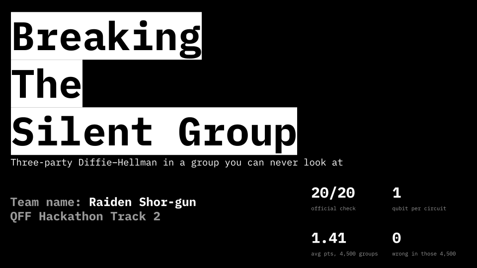

# The Silent Group

*Break a three-party Diffie–Hellman exchange in a group you can never look at.*

**2nd place — Track 2 · [Qiskit Fall Fest 2026](https://qff-website-pi.vercel.app/) Hackathon, BITS Pilani** · Team *Raiden Shor-gun*

*A student-run quantum computing festival, supported by IBM Quantum.*

## The track

A sealed quantum device holds one element of a finite abelian group (|G| ≤ 2⁶⁰)
in a register you can never read. The only primitive is a controlled
multiplication: `oracle_gate(h, k)` multiplies the register by `h^k` conditioned
on a control qubit, costs `bit_length(|k|)` queries per shot from an 80,000
budget, and adds Gaussian phase noise of σ = 0.002·√cost turns.

Three parties run Diffie–Hellman over this group: public `g`, `A = gᵃ`,
`B = gᵇ`, `C = gᶜ`, shared key `K = g^(abc)`. Given the four broadcasts, report
`ord(g)` and `abc mod ord(g)` — or `"none"` if a broadcast is forged.
Full statement: [TASK.md](TASK.md).

## The solution

Every circuit uses **one qubit** — the minimum — measured and reset between
steps, with the inverse QFT done as classically controlled phase corrections
(Griffiths–Niu semiclassical QFT): iterative phase estimation. Each shot yields
a noisy estimate of χ(h) for a uniformly random character χ of G. From there:

- **Order of g** — a short 84-bit probe shot first, upgraded to a full shot only
  when needed; shots combined by 3-D simultaneous Diophantine approximation
  (LLL) with single-flip list decoding.
- **Discrete logs of A, B, C** — log_g X = χ(X)/χ(g) recovered mod n via CRT
  across rounds.
- **Forgery detection** — a χ-independent identity test ("does ∏ h^k = e?")
  with an evidence threshold derived from n; strict tests guard the places
  where a false accept would flip the answer.

**Results:** 20/20 on the official check · 1.41 avg points over 4,500 randomized
stress groups, 0 wrong · ~5–25k of the 80k query budget · correct up to ~1.5×
the competition noise.

## In this repo

- [`solver.py`](solver.py) — the submitted solver (stdlib + qiskit only)
- [`writeup.tex`](writeup.tex) / [`deck.pdf`](deck.pdf) — the writeup and slides
- [`analysis/`](analysis/FINDINGS.md) — the cost & noise model vs measurement
- [`structure.py`](structure.py) — open track: full structure of ⟨g,A,B,C⟩ from
  its relation lattice
- [`bench.py`](bench.py) / [`stress.py`](stress.py) / [`sweep.py`](sweep.py) —
  scoring, fuzzing, and A/B harnesses

The `submission` branch preserves the original single-file `solver.py` upload.
